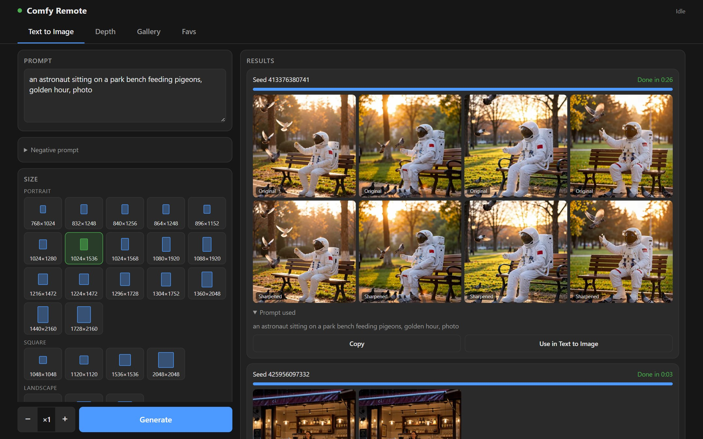
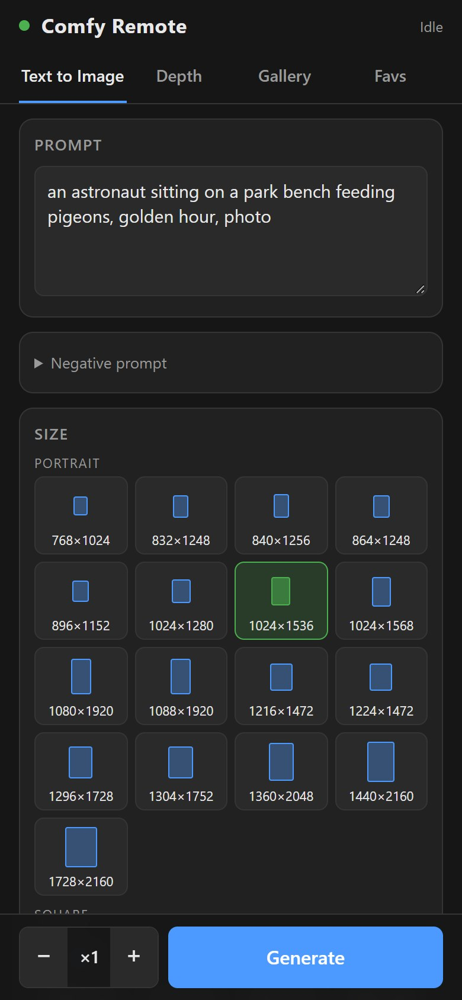
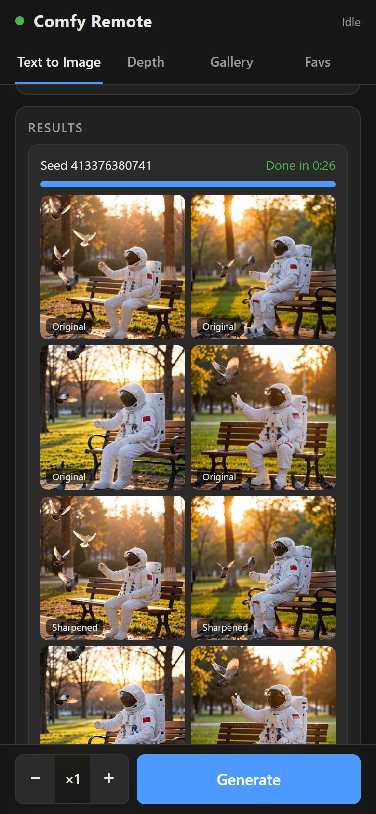
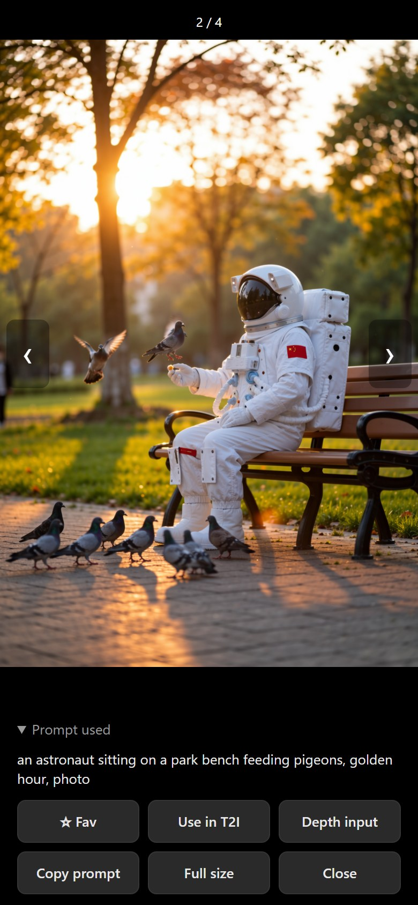
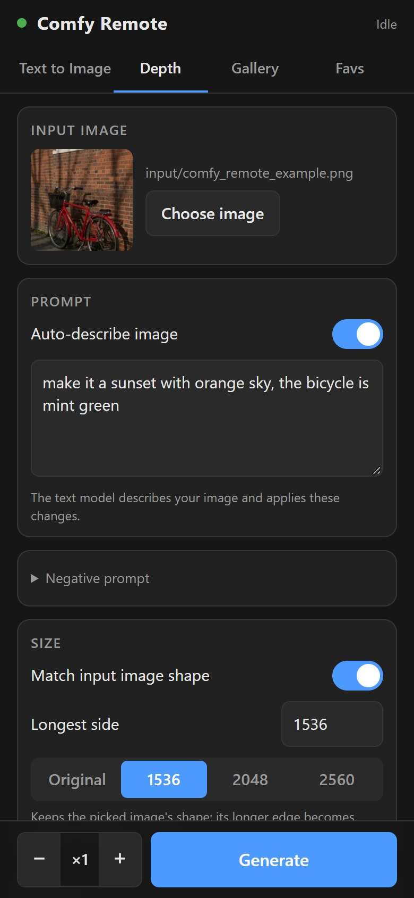
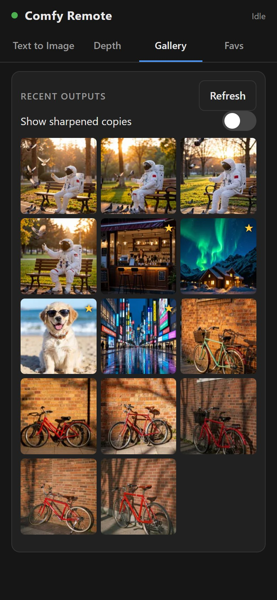
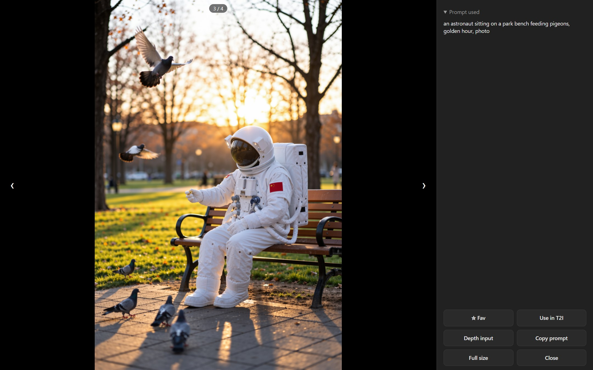
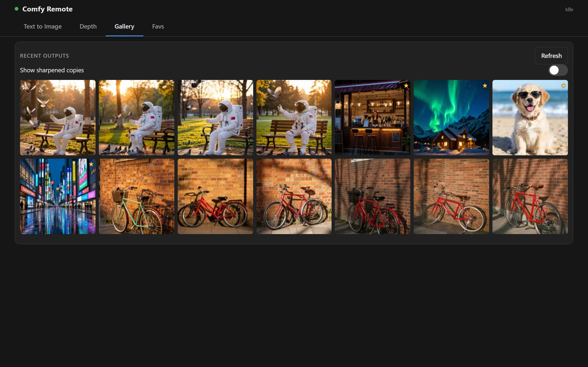
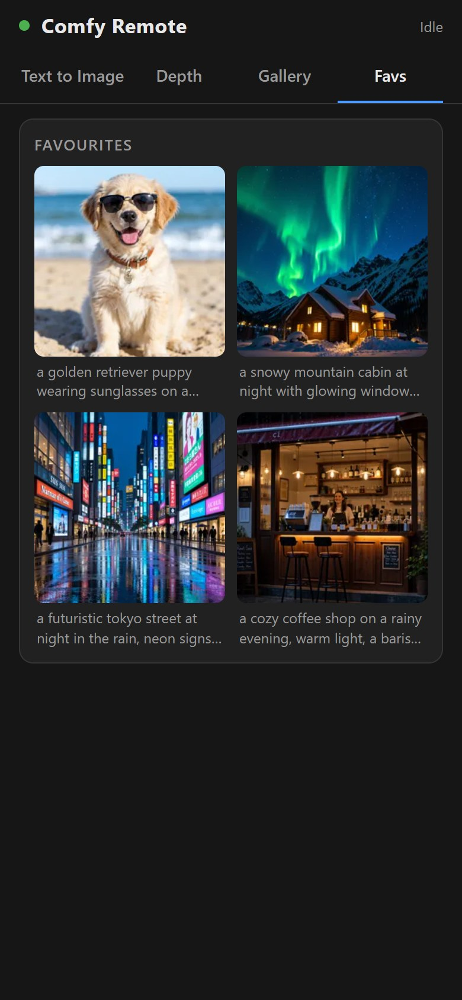

# Comfy Remote

A clean, fast frontend for ComfyUI that works on your **phone** and your **PC**. Type a prompt, tap Generate, and swipe through the results, without touching the node graph. It runs alongside normal ComfyUI, so you can switch between the two any time.

  
  
  
  
  

It ships with a ready-to-go **MOSS Image Turbo** workflow (8-step) with two modes:

- **Text to Image**: prompt, negative prompt, size presets, batch size, LoRAs, seed.
- **Depth**: pick any picture, and the image's shape (depth map) is kept while you change what's in it. **Auto-describe** has the text model write the prompt from your picture, so you only type the changes ("make the bicycle bright blue").

## Features

- **Phone and PC layouts**: one page that adapts to the screen. On a PC, settings sit on the left and results on the right.
- **Live progress** for every job (stage, step count, timer), which survives the phone locking or the page reloading.
- **Generate ×N**: queue several runs in one tap.
- **Gallery** of everything you've made, and **Favs** with each image's prompt saved.
- **Swipe** (phone) or **←/→** (PC) through a batch, the gallery or your favs.
- **Copy a prompt**, or send it straight to Text to Image, from any result.
- **Use any result as the Depth input** in one tap.
- **Pick input images** from the PC's folders, ComfyUI's input/output folders, or upload from the phone.
- **LoRA card**: switch LoRAs on and off, change strengths, add any LoRA from your loras folder.

  
  

  

## Install (Windows, ComfyUI portable)

1. Have [ComfyUI Windows portable](https://github.com/comfyanonymous/ComfyUI/releases), **up to date** (run `update\update_comfyui.bat`). MOSS Image needs a recent ComfyUI.
2. Download **[Install-ComfyRemote.bat](https://github.com/virtamouse/comfy-remote/raw/main/Install-ComfyRemote.bat)** into your `ComfyUI_windows_portable` folder, next to `run_nvidia_gpu.bat`.
3. Double-click it. It:
   - installs the node packs the workflow needs (rgthree-comfy, ComfyUI-KJNodes, comfyui_controlnet_aux) and their Python packages, without touching your torch install,
   - adds the **Comfy Remote - MOSS Turbo** workflow to ComfyUI's workflow list,
   - checks for the models, including folders listed in `extra_model_paths.yaml`, and offers to download what's missing (about 16 GB if you have none),
   - adds two launchers: `run_comfy_remote_LAN.bat` and `run_comfy_remote_TAILSCALE.bat`.

Run it again any time: it only adds what's missing. Add `/update` to also update the node packs. Git is used if you have it; otherwise everything is downloaded as zip files.

### Models

| File | Folder | Size |
|---|---|---|
| moss_image_base_int8_convrot.safetensors | diffusion_models | 5.0 GB |
| Qwen3.5-9B-abliterated_int8_convrot.safetensors | text_encoders | 8.8 GB |
| flux2-vae_small.safetensors | vae | 238 MB |
| 8-steps-dmd2-lora.safetensors | loras | 1.1 GB |
| moss_image_sft.safetensors | loras | 272 MB |
| moss-control.safetensors | loras | 299 MB |

Depth Anything V2 Small is downloaded automatically the first time you use Depth.

## Use

1. Start ComfyUI with one of:
   - `run_comfy_remote_LAN.bat`: phone on the same Wi-Fi,
   - `run_comfy_remote_TAILSCALE.bat`: phone anywhere, through [Tailscale](https://tailscale.com/) (free),
   - `run_nvidia_gpu.bat`: this PC only.
2. Open **http://127.0.0.1:8188/remote** on the PC. The launcher window shows the address for your phone, e.g. `http://192.168.1.20:8188/remote`.
3. On the phone, use *Add to Home Screen* so it opens like an app.

The first run after starting ComfyUI loads the models from disk, which can take a couple of minutes. After that, an image takes seconds.

### Using your own version of the workflow

Comfy Remote runs the groups titled **TEXT TO IMAGE TURBO** and **DEPTH CONTROL TURBO**. Change anything inside them in ComfyUI (models, samplers, extra nodes), then choose **Extensions → Comfy Remote → Send sections to Comfy Remote** and reload the page. Your LoRA list and other settings come from what you send.

### Browsing PC folders

The image picker's **PC folders** tab shows your Pictures, Desktop and Downloads folders. Edit `custom_nodes/comfy-remote/folders.json` to add folders. Set `"drives": true` to allow browsing every drive. Only folder names and image files are ever shown.

## Safety

- ComfyUI has **no password**. `run_comfy_remote_LAN.bat` lets anyone on your Wi-Fi use it, so only use it at home. To use it outside your home, use Tailscale, which only your own devices can reach. Never forward port 8188 on your router.
- The text encoder is an *abliterated* (uncensored) Qwen3.5. You're responsible for what you make: don't create images of real people without their consent.

## Credits

- [MOSS Image](https://huggingface.co/OpenMOSS-Team) by OpenMOSS; ComfyUI support and int8 models by [Comfy-Org](https://huggingface.co/Comfy-Org/MOSS-Image).
- 8-step DMD LoRA from [lodestones](https://huggingface.co/lodestones/MOSS-Image-Base-8-steps-dmd). Model mirror: [Aitrepreneur/FLX](https://huggingface.co/Aitrepreneur/FLX).
- Node packs: [rgthree-comfy](https://github.com/rgthree/rgthree-comfy), [ComfyUI-KJNodes](https://github.com/kijai/ComfyUI-KJNodes), [comfyui_controlnet_aux](https://github.com/Fannovel16/comfyui_controlnet_aux).

MIT license. The models and node packs have their own licenses.
